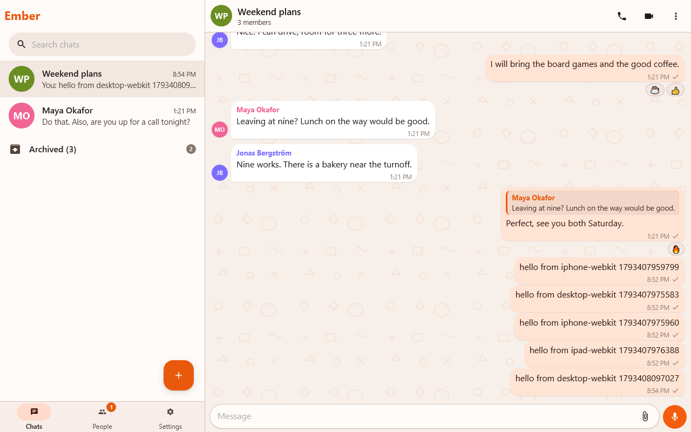
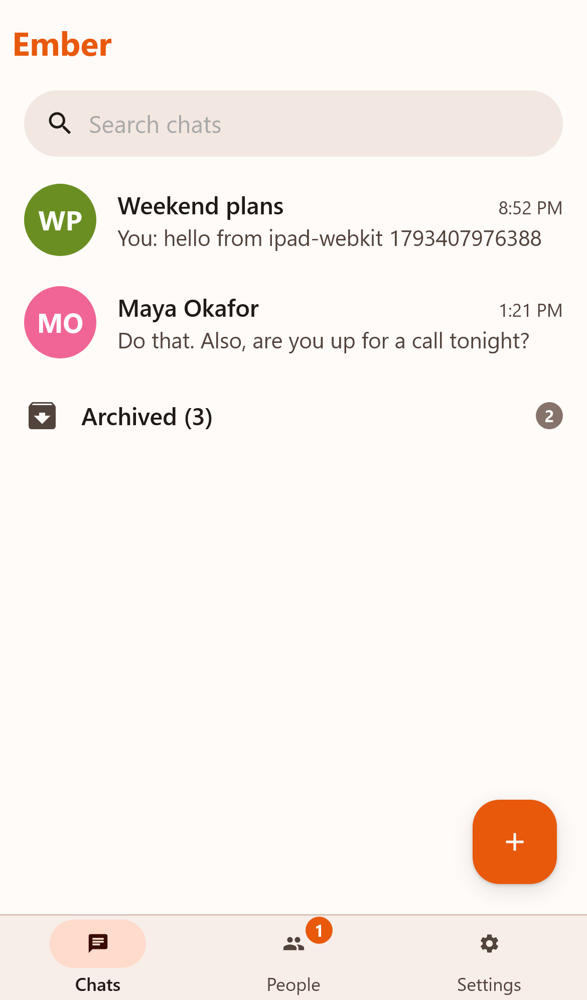
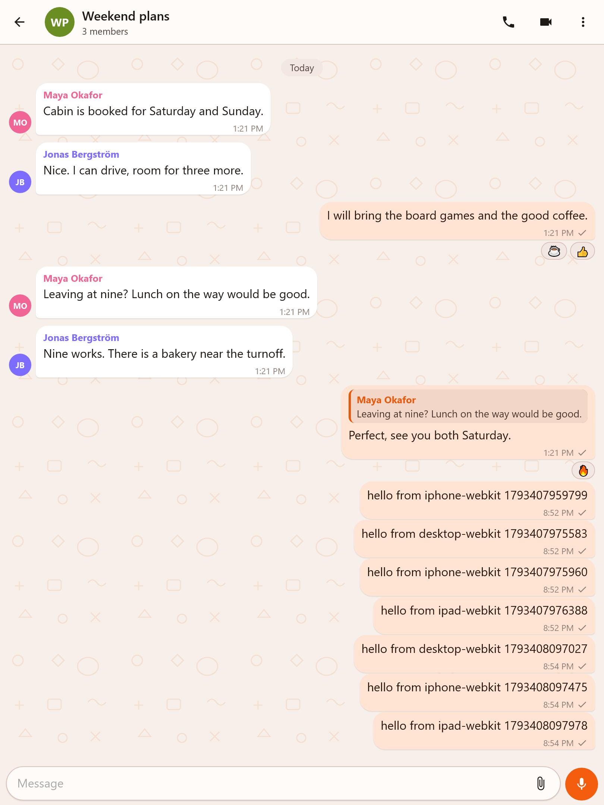

# Ember web

Ember in the browser. It talks to a Hearth server and installs as a PWA. You sign in with your Hearth account. The Android app is not needed.

Live at https://ember.cdsrv.com.



## Features

| Area | Status |
|---|---|
| Sign in, two-step code, sign out | Done |
| Chat list, search, archive | Done |
| Messages: reply, edit, delete, forward, pin, reactions, pick several, swipe to reply | Done |
| Search chats and message text | Done |
| Nudges | Done |
| HD or Standard photos, choose sounds and ringtone, pick call devices | Done |
| Link previews (not in encrypted chats) | Done |
| Photos, files, captions, voice notes | Done |
| Emoji: the Apple set Hearth uses, a picker with search, large single emoji | Done |
| Stickers: favourites, made from any picture, Signal packs, animated emoji, Giphy | Done |
| GIFs: favourites, Reactions, Wikimedia, Giphy, Imgur (own keys in Settings) | Done |
| End-to-end encrypted chats | Done |
| Groups: members, rename, leave | Done |
| People: requests, friend codes, blocked | Done |
| Calls: lobby, ring, video, screen share, fit or fill per tile, minimize to a small window | Done |
| Low battery warnings in calls (20, 15, 10, 5%) | Done where the browser has a battery API |
| Self mirror (default on) and front camera flip for others | Done |
| Push notifications | Done, installed app only on iOS |
| Crash reports to the Hearth server | Done |
| Light, dark, black and system theme, accent colours, chat wallpapers | Done |
| Update prompt | Done |

## Layout

Two panes from 900 px wide. One pane with a bottom bar below that.




## iOS notes

* Push works only after Add to Home Screen.
* Notification permission and audio start from a tap.
* Inputs are 16 px so Safari does not zoom.
* The keyboard height comes from `visualViewport`. Safe areas are respected.
* Voice notes record as `audio/mp4` on WebKit.

## Develop

```bash
npm install
npm run dev
```

The dev server proxies `/api` and `/ws` to a Hearth server. See `vite.config.ts`.

```bash
npm run typecheck
npm test
npm run e2e
```

`npm run e2e` runs iPhone, iPad and desktop WebKit against a local server.

## Deploy

See [DEPLOY.md](DEPLOY.md).

## Tracker

- [x] Core chat
- [x] Encryption
- [x] Calls
- [x] PWA, push, updates
- [x] WebKit smoke tests
- [x] Emoji, stickers, GIFs
- [x] Signal sticker packs
- [ ] Check on a real iPhone
- [ ] Check front camera flip on a Samsung browser
- [ ] Check peer battery warnings with a second device
